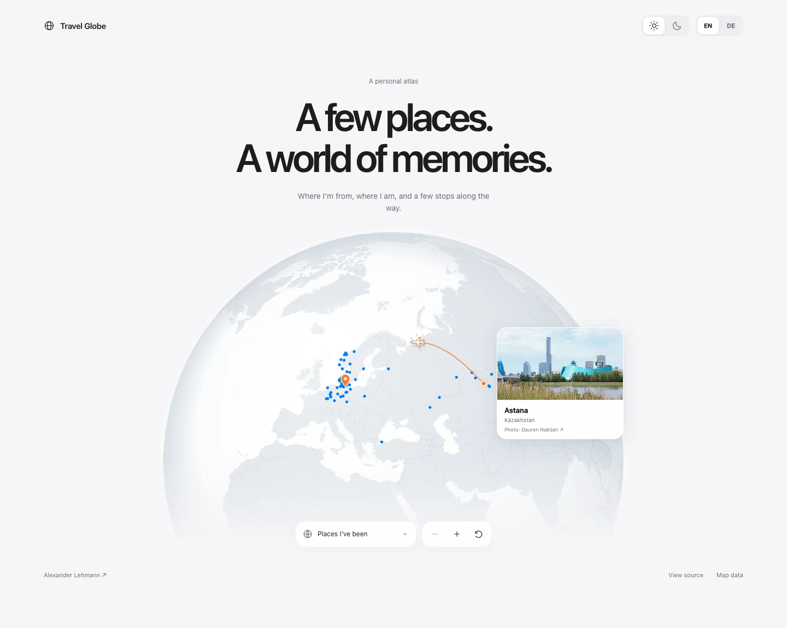

# Travel Globe

**A personal atlas, made for the web.**

[Open the live demo →](https://alxlehmann.github.io/travel-globe/)

An interactive globe for the places that stay with you. Soft land relief, quiet country borders, and a constellation of places visited — with an orange dot for your hometown and a pin for where you live now.

Built with vanilla JavaScript, Canvas 2D, and D3 Geo. Self-hosted from coastlines to city coordinates. No API keys, map subscriptions, framework, or build step.



## A map with a little personality

Drag to turn the globe. Select a place to bring it into view. Hover a dot to see its name, or use the place selector when a cluster gets too dense.

- **City postcards.** Open a place to see a photograph, its name, and its country. Small WebP images load on demand, with linked photographer and licence credits.
- **Personal markers.** An orange dot for your hometown; a matching pin for your current home.
- **A story in motion.** Hover your hometown, tap it, or activate its marker with the keyboard: a small plane follows a raised arc to your current home, leaving a fine trail and a soft arrival ring. The connection illustrates a move, not an actual flight itinerary.
- **A quiet map.** Subtle dashed borders, a softly shaded sphere, and a gentle fade into the page.
- **Touch interaction.** Horizontal dragging rotates the globe on phones while vertical gestures still scroll the page. Zoom buttons work with mouse, touch, and keyboard.
- **Light and dark.** Pale relief by day, graphite tones by night.
- **English and German.** Localized city names, country groups, and controls.
- **Considered motion.** A slow idle drift, eased transitions to selected places, and support for `prefers-reduced-motion`.
- **Local assets.** No third-party requests at runtime. The globe never asks for a visitor’s location.

Originally created for [my portfolio](https://alex-lehmann.com/). The demo includes my own travel history, from Astana to Güstrow and the places in between. Replace it with yours.

## Run it

Clone the repository and serve its root with any static HTTP server:

```sh
git clone https://github.com/alxlehmann/travel-globe.git
cd travel-globe
python3 -m http.server 4174
```

Open **http://localhost:4174**. Use HTTP rather than double-clicking `index.html`: the globe loads its map and place data with `fetch()`.

No package installation or compilation is needed.

## Make it yours

### Add your places

Edit [`assets/data/travel-places.json`](assets/data/travel-places.json):

```json
[
  {
    "id": 0,
    "en": "Astana",
    "de": "Astana",
    "country": "KZ",
    "coordinates": [71.4491, 51.1694],
    "kind": "origin"
  },
  {
    "id": 1,
    "en": "Güstrow",
    "de": "Güstrow",
    "country": "DE",
    "coordinates": [12.1734, 53.7972],
    "kind": "home"
  },
  {
    "id": 2,
    "en": "Copenhagen",
    "de": "Kopenhagen",
    "country": "DK",
    "coordinates": [12.5683, 55.6761],
    "kind": "visited"
  }
]
```

Coordinates are **`[longitude, latitude]`**, in degrees. Give each place a unique numeric `id`. Country codes are ISO 3166-1 alpha-2; country names are generated by `Intl.DisplayNames`.

Use `origin` for one hometown, `home` for one current home, and `visited` for other places. Either special marker may be omitted. Update the initial marker accessibility labels and the `<noscript>` text in `index.html` when changing the demo content; loaded marker labels are generated from the data.

### Optional photographs

Each place may include a `photo` object:

```json
"photo": {
  "src": "img/travel/your-city.webp",
  "author": "Photographer name",
  "license": "CC BY-SA 4.0",
  "licenseUrl": "https://creativecommons.org/licenses/by-sa/4.0/",
  "source": "https://commons.wikimedia.org/wiki/File:Your_photo.jpg",
  "title": "Your photo.jpg"
}
```

Image paths are relative to `assets/`. Keep images small (the demo uses up to 480 pixels wide). Omit `photo` for a text-only place card. Update `sources.html#photo-ID` with the full photographer, source and licence attribution for every replacement; the tooltip links there using the place’s numeric `id`. Copy the credits page when embedding the demo, or adapt the credit URL in `updatePreview()`.

The included photographs have **their own licences**; the repository’s MIT licence does not apply to them.

### Embed it in a page

1. Copy the `assets` directory into your project, preserving its internal paths.
2. Include `assets/css/travel-globe.css` and load `assets/js/travel-globe.js` with `defer`.
3. Copy the `<figure data-travel-globe>` element from `index.html` into your page.
4. Provide these theme variables and the `.sr-only` / `[hidden]` utility styles from `demo.css`:

```css
:root {
  --paper: #f5f5f7;
  --ink: #1d1d1f;
  --secondary: #676971;
  --font: -apple-system, BlinkMacSystemFont, "Segoe UI", sans-serif;
}
```

The standalone page styles live in `demo.css`; the globe styles live in `travel-globe.css`. The renderer currently supports one globe per page.

### Theme and language

Set the document attributes, update your theme variables, and dispatch the corresponding event:

```js
// Dark mode: also set --paper, --ink and --secondary in your CSS.
document.documentElement.dataset.theme = 'dark';
document.dispatchEvent(new CustomEvent('travel-globe:appearance'));

// Supported languages: en, de.
document.documentElement.lang = 'de';
document.dispatchEvent(new CustomEvent('travel-globe:language'));
```

See `demo.js` for a small, framework-free example. Add further languages to the renderer’s `copy` dictionary and language selection logic, as well as to your place data.

### Initial view

The initial longitude, latitude, and zoom are defined near the top of `travel-globe.js`. To change the default region, update those values, the idle-drift centre in `frame()`, and the target in `reset()` together. Projection scale and globe placement are in `resize()` and `project()`.

## Under the surface

D3 Geo projects geographic data onto an orthographic sphere. Canvas draws the land, shading, borders, and visited dots; SVG markers and HTML tooltips sit above it. This is a geographic projection with simulated depth, not a WebGL scene or a video.

- Map data and rendering libraries load when the globe approaches the viewport.
- Continuous animation targets approximately 30 fps; display density is capped at 1.75×.
- The land surface is cached between view changes, so the flight animation reuses it instead of repeatedly projecting every coastline.
- Rendering stops when the globe is far offscreen or the browser tab is hidden.
- Idle motion stops after interaction. The globe then redraws for user input and view transitions.
- Reduced-motion preferences disable idle drift, make view transitions immediate, and show a static relocation arc instead of a moving plane.
- A native grouped place selector provides a keyboard-accessible alternative to pointing at small dots. Icon buttons have accessible names, and selected places are announced through a live region.

The base map data and vendor scripts total roughly **950 KB before HTTP compression**. The optional photo collection adds about **2 MB on disk**, but no photographs load until a place is opened (approximately **33 KB per image** on average). Enable gzip or Brotli on your host and use asset caching. Rendering cost still depends on the device; this is an animated map, not a static image.

Requires a modern browser with Canvas 2D, `fetch`, Pointer Events, `IntersectionObserver`, `ResizeObserver`, and `Intl.DisplayNames`.

## Project layout

```text
index.html                         Standalone demo and reusable globe markup
sources.html                       Full photo attribution, linked from each card
assets/
  img/travel/                      On-demand city photographs (WebP)
  css/demo.css                     Demo shell and theme variables
  css/travel-globe.css              Globe, markers, tooltips, controls
  js/demo.js                       Demo theme and language controls
  js/travel-globe.js                Projection, interaction, rendering
  data/travel-places.json           Editable travel history
  data/globe-land-50m.json          Natural Earth land geometry (TopoJSON)
  data/globe-borders-50m.json       Internal country boundaries (GeoJSON)
  vendor/globe/                    Pinned local libraries and licence texts
docs/travel-globe-preview.webp     README preview
LICENSE                            MIT licence for original code
THIRD_PARTY_NOTICES.md              Data and dependency credits
```

## Credits and licence

Created by [Alexander Lehmann](https://alex-lehmann.com/).

Original code is licensed under [MIT](LICENSE). Map data comes from [Natural Earth](https://www.naturalearthdata.com/about/terms-of-use/) via [World Atlas](https://github.com/topojson/world-atlas), and is public domain. D3 and TopoJSON retain their ISC licences. Photographs retain their individual CC BY, CC BY-SA, CC0 or public-domain terms, as listed on the [photo credits page](https://alxlehmann.github.io/travel-globe/sources.html). See [third-party notices](THIRD_PARTY_NOTICES.md).

Points represent approximate locations. The relocation arc is illustrative, not a flight itinerary. Geographic boundaries follow the source dataset and are provided for visual context.
